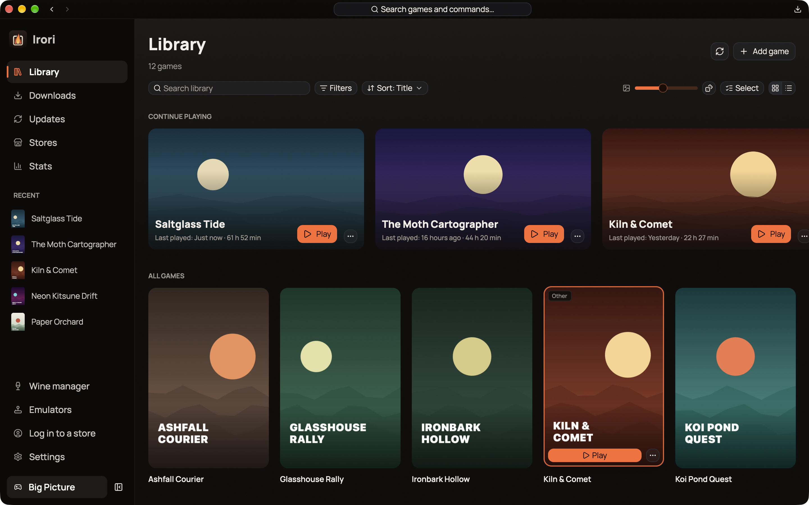
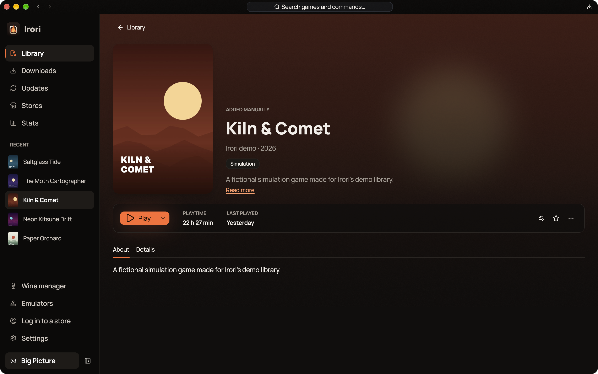
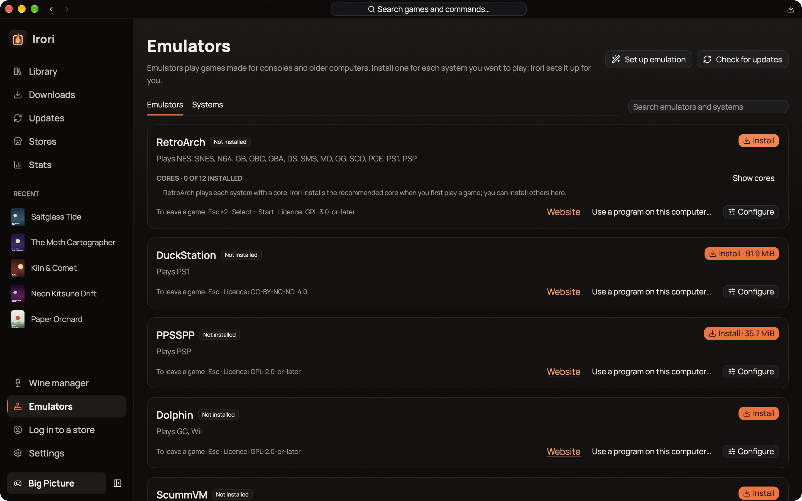
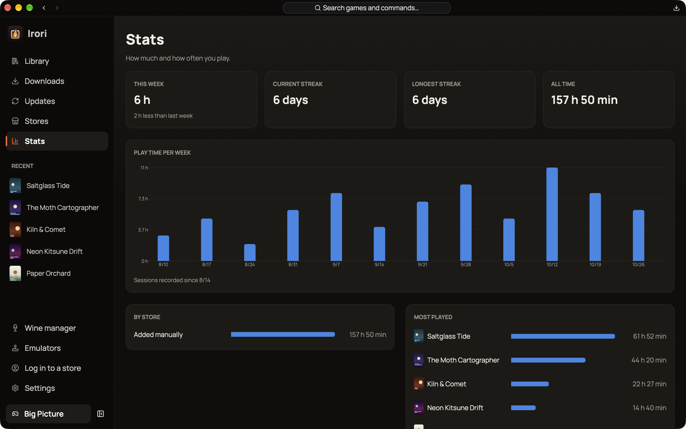
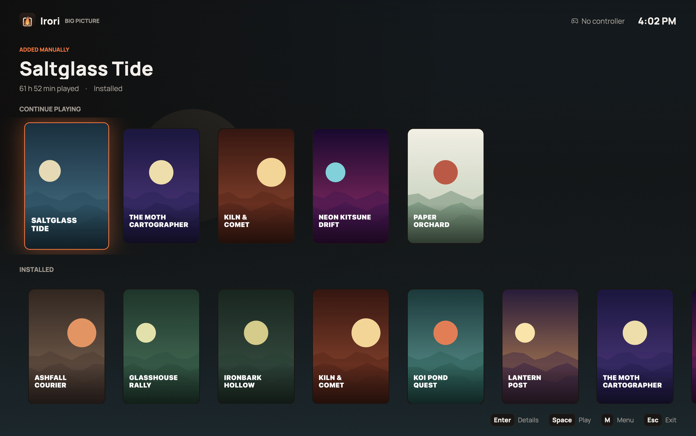

# Irori

An *irori* is the sunken hearth of a traditional Japanese house, the place everyone gathers. Irori is a fast, native game launcher for Linux, macOS and Windows that gathers your Epic Games, GOG, Amazon Games, ZOOM Platform and itch.io libraries, your Steam games, your emulated games and anything you add yourself into one calm library.

It is built from scratch in Rust with GPUI and GPUI Kit to match the feature set of Heroic Games Launcher without Electron: one native process, a GPU-rendered interface, no CPU use while idle, and bounded memory. Every long list is virtualized, and cover art is thumbnailed once to disk and held in a bounded GPU cache.

## One library

Search, filter and sort across every store, with categories, favourites and hidden games, grid and list views, and a "Continue playing" row. Several accounts per store live in the same library, and each installed game launches with the account it was installed with. A command palette reaches any game or page from the keyboard, and the tray menu keeps recent games one click away.

## One click to play

Windows games run natively on Windows, through Wine, Proton or umu on Linux, and through Wine, CrossOver or Game Porting Toolkit on macOS. The Wine manager downloads and updates builds and finds the ones already on the system, while per-game settings inherit your global defaults and show what you changed. Cloud saves keep Epic and GOG games in sync, and a conflict stops the launch and asks which saves to keep.

## Downloads and updates

The download queue pauses and resumes, reorders, shows speed and time left, and picks up where it stopped after a restart. A single Updates page covers games, Wine and Proton builds, DXVK, VKD3D-Proton, umu, emulators and RetroArch cores, and automatic updates can keep to set hours and stay off metered connections. Store protocols are built in, so Irori needs no external store tools.

## Emulators

A ROM library scans your folders and plays them with emulators that Irori installs from each project's own servers: RetroArch and its cores, DuckStation, PPSSPP, Dolphin, ScummVM, DOSBox Staging, PCSX2, melonDS, mGBA, Azahar and more. It picks a sensible emulator for each system, side-by-side versions keep a game pinned to the one it works with, and missing cores install on the way to the first launch.

## Stats

Irori keeps a history of play sessions and shows how much and how often you play: time per week, streaks, totals by store and your most played games.

## Big Picture

A full-screen mode for the couch and for handhelds, with full controller navigation for Xbox, PlayStation, Switch Pro and Steam Deck controllers. Controllers reach every screen in the app, and the Guide button opens Big Picture from anywhere.

## Bring what you have

Import accounts, installs, settings, favourites and categories from Heroic in one step, and read games, categories and playtime from Lutris without changing anything there. Steam games show up from Steam's own files with no login, and logging in adds every game you own. Battle.net, EA app, Ubisoft Connect and Rockstar games can join the library too, and Irori follows their sessions so playtime counts.

Irori is translated into 19 languages, switchable live, and is open source under the MIT License.

[Official website](https://irori.app)

[GitHub repository](https://github.com/irori-app/irori)
